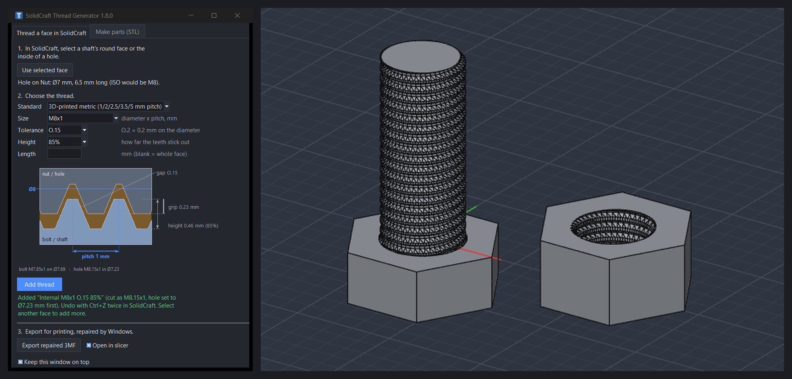

# SolidCraft Thread Generator

3D-printable threads for [SolidCraft](https://github.com/tangency-labs/solidcraft):
select a shaft or a hole in SolidCraft, pick a size, tolerance and height, and
the thread is cut into your model. It can also export a repaired 3MF for your
slicer, and make bolts, nuts, threaded rods and thread cutters as STL.



## Install

1. Download `thread-generator-<version>.zip` from
   [Releases](https://github.com/Stigern/SolidThreadsPlugin/releases).
2. In SolidCraft open **Preferences → Plugins → Show in folder** and unzip the
   zip there, so you get `plugins\thread-generator\plugin.json`
   (on Windows: `%LOCALAPPDATA%\SolidCraft\plugins`).
3. Reopen Preferences → Plugins: **Thread Generator** is listed.
4. Start **ThreadGenerator.exe** from that folder. No Python needed. Windows
   may show "Windows protected your PC" because the program isn't code-signed:
   click *More info → Run anyway*.

Or unzip it anywhere, run the exe and click *Install as SolidCraft plugin*.
Files are saved to `Documents\SolidCraft Threads` (change it in the window).

SolidCraft's plugin system currently lists plugins but doesn't run them yet, so
the generator opens in its own window. When SolidCraft can run plugins
([#1221](https://github.com/tangency-labs/solidcraft/issues/1221)) it can move
inside the app.

## Thread a face in SolidCraft

The first tab works on the design you have open in SolidCraft (0.22 or later):

1. In SolidCraft, select the round face of a shaft, or the inside of a hole.
2. Click **Use selected face**. The generator reads whether it's a shaft or a
   hole, its diameter and length, and picks a size.
3. Pick the **size**, **tolerance** and **height**, and optionally a shorter
   length. The defaults are M8x1, O.15 and 85%.
4. Click **Add thread**. SolidCraft cuts a modeled thread into the body. It's a
   normal feature in the timeline, named for example "External M8x1 O.15 85%",
   and Ctrl+Z in SolidCraft undoes it.

**Sizes.** A size is diameter × pitch: M8x1 is 8 mm across with 1 mm from one
thread crest to the next; a larger pitch gives deeper, coarser teeth. Pick a
size from the list or type your own, like `M9x1.5`. When you use a new face,
the pitch of the current size is kept and the diameter follows the face.

The default standard, *3D-printed metric*, follows
[CustomThreads](https://github.com/BalzGuenat/CustomThreads) (MIT): the ISO 60°
profile with a coarse pitch, 3.5 or 5 mm for M8–M50, plus 2.5 mm for M6–M50,
an experimental 2 mm pitch for M4–M50 (on M4–M5 the core left inside the thread
is only about half the diameter) and a fine 1 mm pitch for M4–M50. Fine threads
are shallow: 1 mm pitch is about 0.54 mm deep, which needs a printer that holds
small detail; 2.5 mm is about 1.35 mm deep and 3.5 mm about 1.9 mm. ISO metric
(M1–M48, including M4x0.7), fine and UNC sizes are there for parts that must fit
metal screws.

Model the parts at the nominal size: a shaft at the thread diameter (8 mm for
M8x1), and a hole at diameter − pitch (7 mm for M8x1). The generator picks the
size from that, and warns when a hole doesn't match the thread.

**Tolerance** uses CustomThreads' classes (O.0, O.1, O.15, O.2, O.4, O.8):
O.2 makes this part 0.2 mm looser on each diameter (a shaft 0.2 mm smaller, a
hole 0.2 mm larger). Printing both a bolt and a nut? Give both a class: start
with O.2 on both, go to O.4 if it's tight, O.15 or O.1 if it's loose. Any
number in mm works too.

**Height** sets how far the teeth stick out: 100% is the full ISO height;
95%, 90%, 85%, 80%, 75% and 70% (or any value from 50% you type) give lower
teeth with flat tops. The shaft is first made thinner
(or the hole wider) and then threaded, so only the tips of the teeth go; the
flanks stay where they are, and a bolt and nut with the same height still fit.
They grip over less depth: for M10x2.5 with O.2 the grip is 1.16 mm at 100%,
0.62 mm at 80% and 0.35 mm at 70%. Use the same height on both parts. A lower
thread is two steps in the timeline (the face change and the thread), grouped
in a folder, so Ctrl+Z twice undoes it.

The drawing under the settings is a to-scale section through a bolt and a nut
with the current settings: pitch, height, grip, the tolerance gap and the
nominal diameter. Hover over a setting (or click into it) to see its part of
the drawing highlighted. The window follows SolidCraft's light or dark theme
(or Windows' when SolidCraft isn't running).

**Export for printing.** SolidCraft's modeled threads are made of many small
facets, and slicers sometimes find small errors in them. *Export repaired 3MF*
saves the selected body (or all bodies, when nothing is selected) as 3MF and
runs Windows' own model repair on it, the same repair 3D Builder and the
slicers' "Fix model" use: holes closed, flipped and crossing triangles fixed.
The result goes to `Documents\SolidCraft Threads` and, with *Open in slicer*,
opens in the program 3MF files open with. Your design in SolidCraft is not
changed. Needs Windows 10 or 11 (it runs `winrepair.ps1` in Windows PowerShell).

Threads are cut into the whole body, and SolidCraft turns every round face of
that body into small flat facets. Keep separate parts as separate bodies
(*New Body* when you extrude) so only the threaded part is affected.

The window stays on top of SolidCraft so you can keep selecting faces.

SolidCraft is optional: without it you can still save STLs for your slicer.
With it, *Preview* and *Open in SolidCraft* work. If SolidCraft is installed
somewhere other than `C:\Program Files\SolidCraft`, click *Locate SolidCraft…*.

From source: run `python "Thread Generator.pyw"` (Python 3.10+, standard library
only). `build.bat` rebuilds the .exe and the release zip (needs PyInstaller);
`build.bat --install` also installs it in your SolidCraft plugins folder.

## Options

| Option | Meaning |
|---|---|
| Standard / Size | ISO metric coarse & fine, UNC, trapezoidal (Tr), large jar threads, or Custom |
| Diameter, Pitch | Nominal outer diameter and distance between crests (mm). Editable for any size |
| Profile | 60° V (ISO/UNC), 30° trapezoidal, 29° ACME, square, buttress |
| Starts | Multi-start threads (each turn advances starts × pitch). Bolt and nut must match |
| Depth | Thread depth. Blank = standard for the profile |
| Left-hand | Reverse thread |
| Clearance | Gap added to every surface of the part (normal to the surface, so flanks get the same gap as crests). A printed bolt and nut get **2 × clearance** between them; one printed part still fits a metal one. FDM 0.1–0.2 mm, resin 0.05–0.1 mm |
| Chamfer | Lead-in bevel on thread ends (blank = automatic) |
| Length / Plain shank | Shaft length under the head, and the unthreaded part of it |
| Head / Nut shape, width, height | hex, round or square. Width is across the flats. Blank = ISO-like sizes |
| Quality | draft / normal / fine mesh density |

## Thread cutter

SolidCraft can't subtract a mesh from a solid body, so use the cutter in your
slicer instead: in Bambu Studio / OrcaSlicer / PrusaSlicer, right-click your
model → *Add negative part → Load…* and pick the cutter STL. Position it where
the hole should be. It cuts a threaded hole that fits a bolt of the same size.

## Command line

```
python threadgen.py pair --size M8 -l 25 -c 0.15 --open
python threadgen.py rod  --size Tr8x2 --starts 4 -l 100 -o out
python threadgen.py nut  -d 40 -p 4 --profile buttress --nut round --nut-flats 50
python threadgen.py --help
```

`--design` writes a `.solidcraft` file next to the STLs; `--open` opens it in SolidCraft.
Set `SOLIDCRAFT_HOME` if SolidCraft isn't installed in `C:\Program Files\SolidCraft`.
